<div align="center">



<p>
  
  
  
  
</p>

<p><em>An interactive 2025/26 annual report for a concept urban rewilding project:<br>
52 rooftop apiaries and wildflower meadows across 11 London boroughs, and what they changed.</em></p>

</div>


## What it is

Annual reports are usually a PDF nobody opens. This one is a page you explore: a pollinator map of the Thames corridor, biodiversity curves you can filter, a stormwater and urban-heat simulator, and community stories, with a one-click PDF export at the end.

| 11 | 52 | 194 | 9.7M+ |
|:-:|:-:|:-:|:-:|
| boroughs | rooftops | hives | bees |


## Features

| | |
|---|---|
| **Pollinator map** | A D3-geo map of the boroughs with rooftop sites and corridors you can hover and select. |
| **Biodiversity curves** | Species and pollinator counts over the season, filterable by borough. |
| **Climate simulator** | Rainwater retention and urban heat-island effects of the green roofs. |
| **Community impact** | Honey donated to food banks, volunteer hours and school visits. |
| **Report assistant** | Ask questions about the numbers in plain language. |
| **PDF export** | The whole report, laid out for print. |


## Türkçe özet

**London Bee Project Interactive Annual Report**, Londra'nın 11 ilçesindeki 52 çatı arılığı ve yaban çiçeği çayırının ekolojik, iklimsel ve toplumsal etkilerini gösteren etkileşimli bir yıllık rapor. Thames koridorunun polinatör haritası, filtrelenebilir biyoçeşitlilik eğrileri, yağmur suyu ve kentsel ısı adası simülatörü ve topluluk hikâyeleri içeriyor; rapor tek tıkla PDF olarak indirilebiliyor. Kavramsal bir proje için hazırlanmış bir veri görselleştirme çalışması.


## Development

```sh
npm install
cp .env.example .env.local   # optional Gemini key for the report assistant
npm run dev                  # http://localhost:3000
npm run build
```

```
src/components/   map, charts, simulator, story sections, export
src/data/         boroughs, sites, metrics
src/utils/        geo and number helpers
```

<div align="center">
<br>
<a href="https://github.com/kutluhangil"></a>
<sub>A data-visualisation study · the project and its figures are illustrative.</sub>
</div>
